# JomDekan

[](https://github.com/nurinirdnz/Jom-Dekan/actions/workflows/ci.yml)
[](https://www.typescriptlang.org/)
[](https://react.dev/)
[](https://nodejs.org/)
[](https://www.postgresql.org/)

A full-stack academic community platform for Malaysian university students.

JomDekan brings academic resources, discussions, peer tutoring, freelance opportunities, messaging, reporting, and administration into one centralized and accessible platform.

> Portfolio project built with React, TypeScript, Express, PostgreSQL, Redis, and Docker.

🎥 **[Watch the demo video](https://youtu.be/wZzSffhAfEg)**

[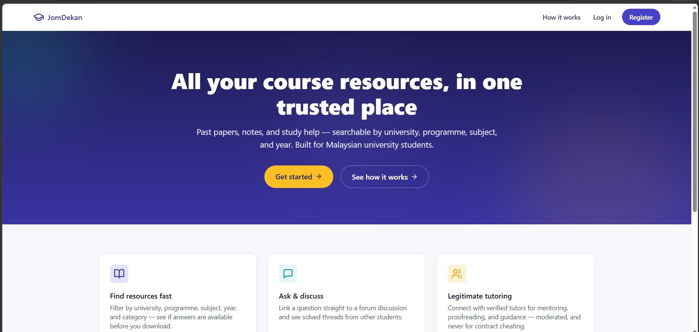](https://youtu.be/wZzSffhAfEg)

---

## Overview

University students often rely on disconnected messaging groups, cloud folders, and social media pages to find academic resources or help from other students.

JomDekan provides a structured platform where students can:

- Share and discover academic resources
- Generate AI-assisted resource summaries
- Ask questions and participate in discussions
- Find tutors and request tutoring sessions
- Browse or publish student freelance opportunities
- Communicate through private messages
- Save favourite content
- Report inappropriate or suspicious activity
- Manage their profile, notifications, and bookings

Administrators receive a dedicated portal for moderation, user management, academic taxonomy, tutoring applications, listings, notifications, analytics, and audit logs.

---

## Feature tour

### Student dashboard

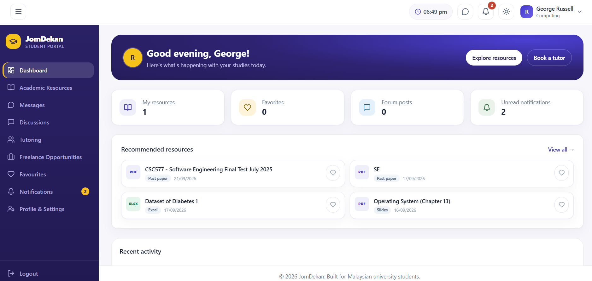

After logging in, students land on a personalised dashboard with shortcuts to resources and tutoring, counts of their uploads, favourites, forum posts, and unread notifications, plus recommended resources and recent activity.

### Academic resources

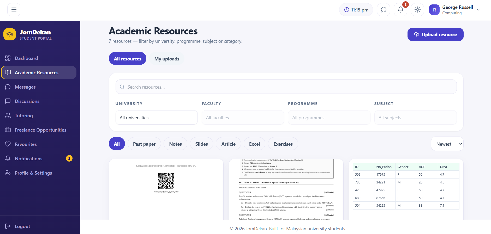

Students can browse and upload past papers, notes, slides, articles, spreadsheets, and exercises.

- Search, then filter by university, faculty, programme, subject, and category
- Live first-page previews for PDFs and first-row previews for Excel spreadsheets
- Switch between all resources and your own uploads
- Save favourites and report inappropriate resources
- Downloads use short-lived signed URLs that re-check access on every request

### AI study tools

| AI study summary                                | Ask AI about this resource                        |
| ----------------------------------------------- | ------------------------------------------------- |
| 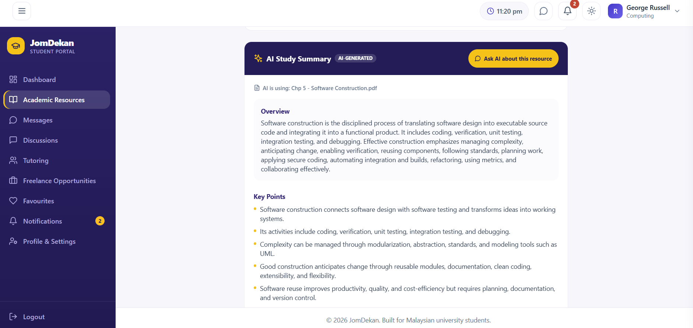 | 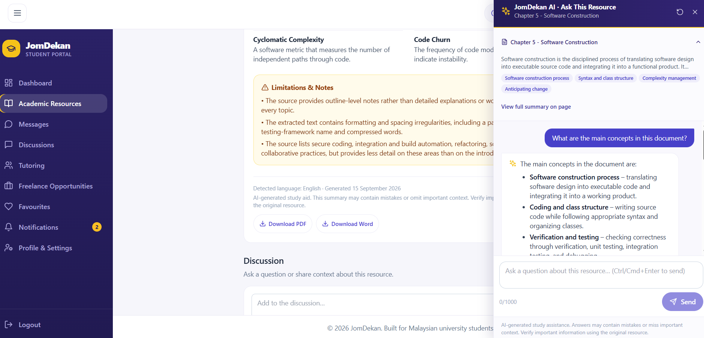 |

Each resource can generate an **AI study summary** with an overview, key points, key terms, and a "Limitations & Notes" section that flags gaps in the source. Summaries show which file the AI used and can be downloaded as PDF or Word.

The **Ask This Resource** assistant answers questions using the resource's content. Both features are clearly labelled as AI-generated and remind students to verify against the original material.

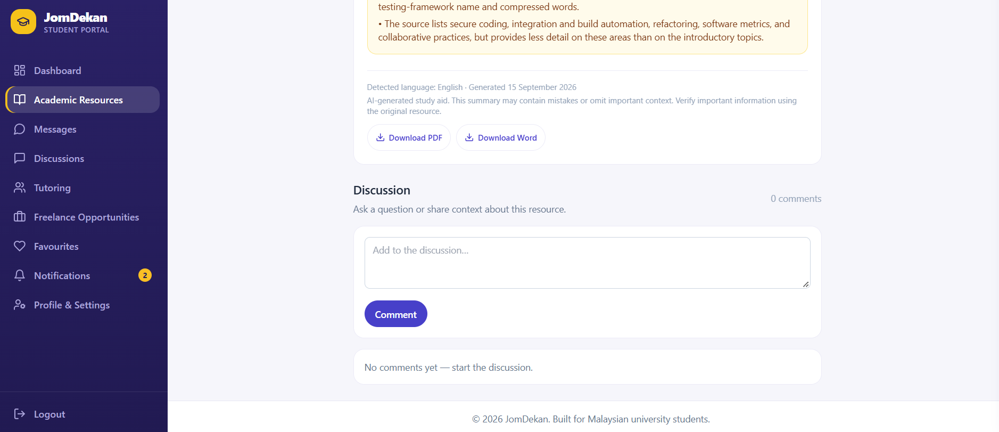

Every resource also has its own discussion section for questions and extra context.

### Discussions and messaging

| Discussion forum                            | Private messages and booking requests |
| ------------------------------------------- | ------------------------------------- |
| 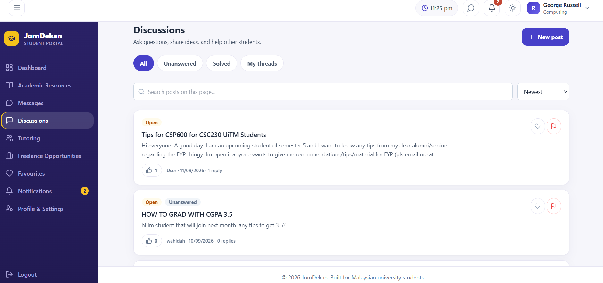 | 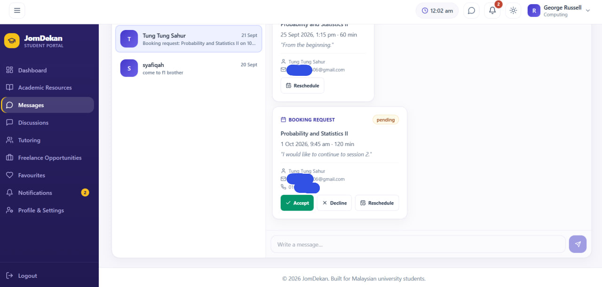 |

- Create discussion threads, then filter by unanswered, solved, or your own threads
- Like, save, and report posts
- Private one-to-one messaging between students
- Tutoring booking requests arrive in the conversation, where the tutor can accept, decline, or reschedule

### Tutoring marketplace

| Tutor listings                                    | Tutor profile                                   |
| ------------------------------------------------- | ----------------------------------------------- |
| 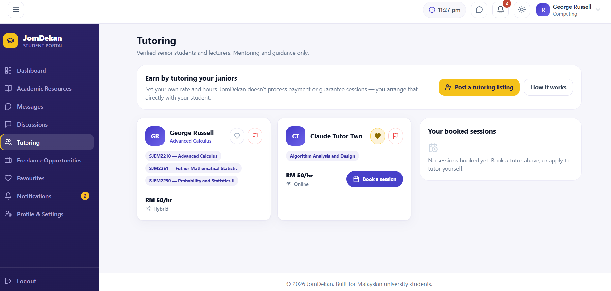 | 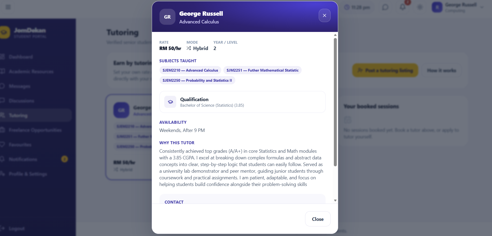 |

- Senior students and lecturers can apply to tutor and upload a résumé or CV
- Listings show subjects, hourly rate, and session mode (online, in person, or hybrid)
- Tutor profiles include qualifications, availability, and teaching background
- Tutors can accept students from other universities and programmes
- Students request sessions and track their bookings
- Every tutor and listing is reviewed by an administrator

JomDekan does not process payments. Tutors and students arrange sessions directly.

### Freelance opportunities

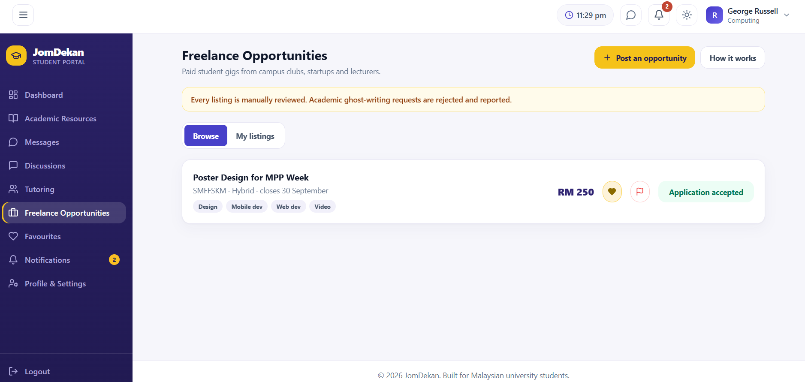

Campus clubs, startups, and lecturers can post paid student gigs.

- Listings specify the budget, required skills, work mode, and application deadline
- Students apply with a CV or portfolio file and see their application status
- Every listing is manually reviewed, and academic ghost-writing requests are rejected

### Favourites, notifications, and profile

| Saved items                               | Notifications                                           |
| ----------------------------------------- | ------------------------------------------------------- |
| 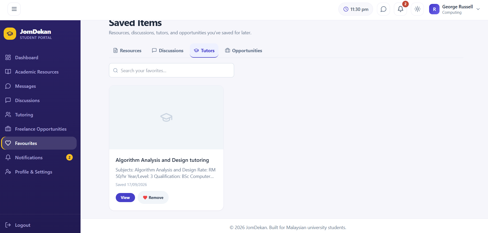 | 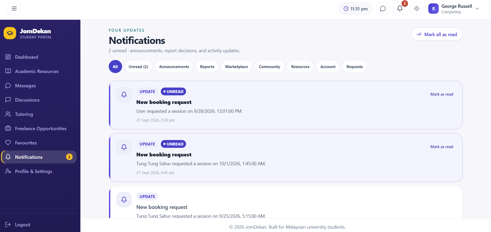 |

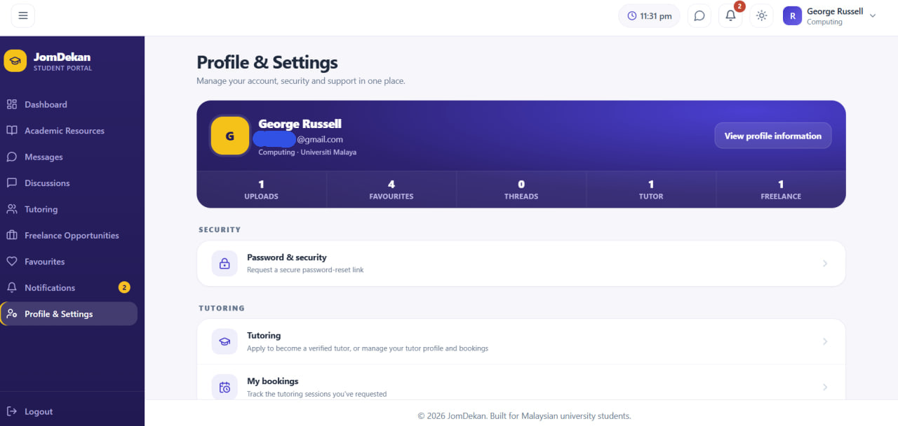

- Save resources, discussions, tutors, and opportunities in one place
- Notifications are grouped into announcements, reports, marketplace, community, resources, account, and requests
- The profile page shows each student's activity and links to password and security settings, tutoring, and bookings

### Administration and moderation

| Admin analytics                                               | User management                                                 |
| ------------------------------------------------------------- | --------------------------------------------------------------- |
| 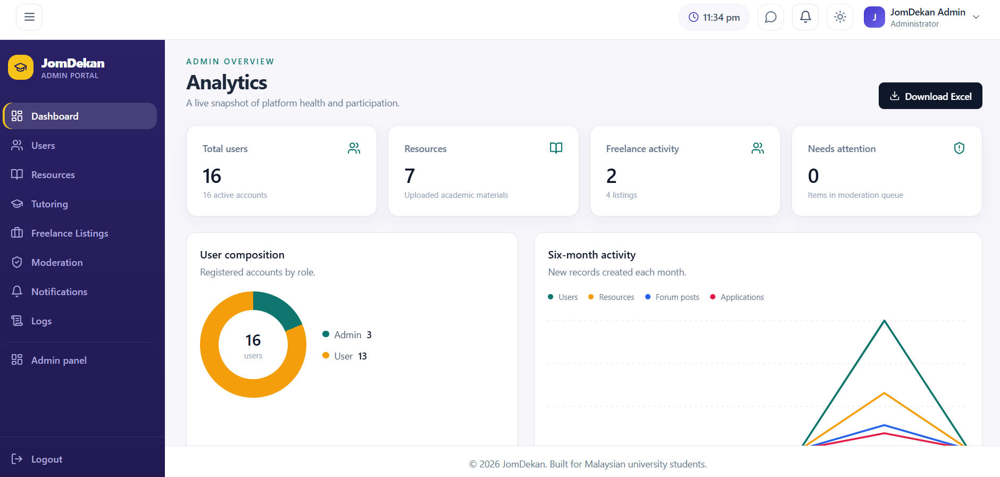 | 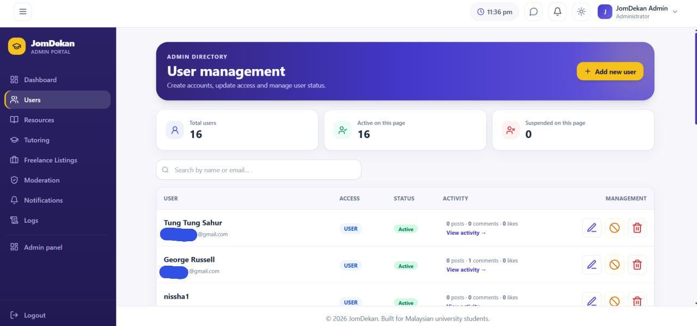 |

Administrators get a separate portal with:

- Platform analytics showing user composition and six-month activity, exportable to Excel
- User management to create, edit, suspend, and delete accounts and view each user's activity
- Resource, tutoring, and freelance listing management
- Tutor application review
- Academic taxonomy management (universities, faculties, programmes, subjects)
- Announcements and audit logs

| Moderation queue                                      | Moderation decision                                             |
| ----------------------------------------------------- | --------------------------------------------------------------- |
| 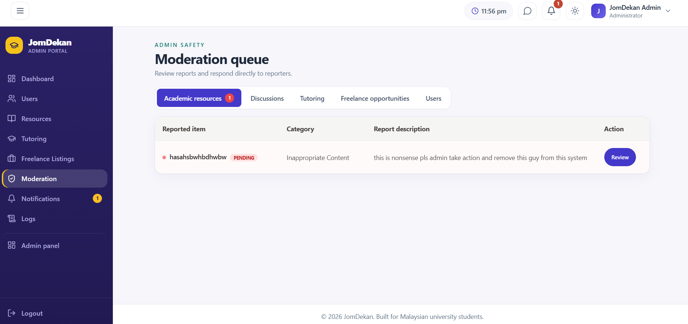 | 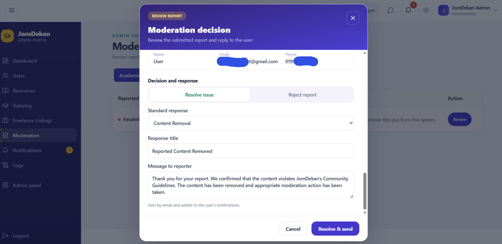 |

Reports are grouped by content type: resources, discussions, tutoring, freelance opportunities, and users. Administrators open a full preview of the reported content, then resolve or reject the report using a standard response template. The reporter is notified by email and in-app notification.

### Accessibility and theming

- Responsive interface
- Light and dark modes
- Theme-aware cards, dialogs, tables, forms, and navigation
- Accessible hover, focus, selected, disabled, error, warning, and success states
- Improved contrast across student and administrator interfaces

### More features

These features aren't shown in the screenshots above.

#### Email notifications

JomDekan emails users about important events. It supports SMTP, Resend, or SendGrid, plus a console mode for local development that logs emails instead of sending them. Emails are sent in the background, so a slow provider never delays the app.

| Area       | Emails sent                                                                                                            |
| ---------- | ---------------------------------------------------------------------------------------------------------------------- |
| Accounts   | Email verification on sign-up, password reset links, and notices when an account is disabled, re-enabled, or deleted   |
| Tutoring   | Tutor application approved or declined, tutor status revoked, new session requests, booking decisions, and reschedules |
| Freelance  | New applications to the poster and application status updates to the applicant                                         |
| Moderation | New reports to administrators, decisions to the reporter, and notices to the author of removed content                 |
| Support    | Support requests and suggestions to administrators                                                                     |

#### Google Calendar sync

Tutors can connect their Google Calendar. Confirmed tutoring sessions are added to it automatically, and the calendar stays in sync when a session is rescheduled.

#### Accounts and security

- Registration with email verification
- Forgot-password and reset-password flow
- Temporary account lockout after repeated failed login attempts
- Public user profiles

#### Uploads and reporting

- Resource uploads tagged by university, faculty, programme, subject, and category
- Every upload is size-checked, signature-validated, and malware-scanned
- Reports can include screenshot evidence

#### Community-driven academic taxonomy

Students can add a subject that is missing from the list. It's marked as not yet verified until an administrator reviews the request.

#### Help and support

- Help page, "How it works" guide, and privacy policy
- In-app support requests and suggestions, sent to administrators in-app and by email

#### Additional admin tools

- Tutor application review, including résumés
- Taxonomy request review, plus management of universities, faculties, programmes, and subjects
- Platform-wide announcements
- Audit logs showing which administrator did what, and when
- Detailed per-user views

---

## Technology stack

| Area                      | Technologies                                         |
| ------------------------- | ---------------------------------------------------- |
| Frontend                  | React 18, TypeScript, Vite, React Router             |
| State and data            | TanStack Query, Zustand, Axios                       |
| Forms and validation      | React Hook Form, Zod                                 |
| Styling                   | Tailwind CSS, custom theme-aware CSS                 |
| Backend                   | Node.js, Express, TypeScript                         |
| Database                  | PostgreSQL 16                                        |
| Caching and rate limiting | Redis 7, in-memory development fallback              |
| Authentication            | JWT access and refresh tokens, secure cookies        |
| File storage              | Local filesystem or S3-compatible storage            |
| Malware scanning          | Configurable ClamAV integration and development stub |
| AI features               | OpenAI API                                           |
| API documentation         | Swagger / OpenAPI                                    |
| Testing                   | Jest, Supertest, Vitest, Testing Library, Playwright |
| Infrastructure            | Docker Compose, GitHub Actions                       |

---

## Architecture

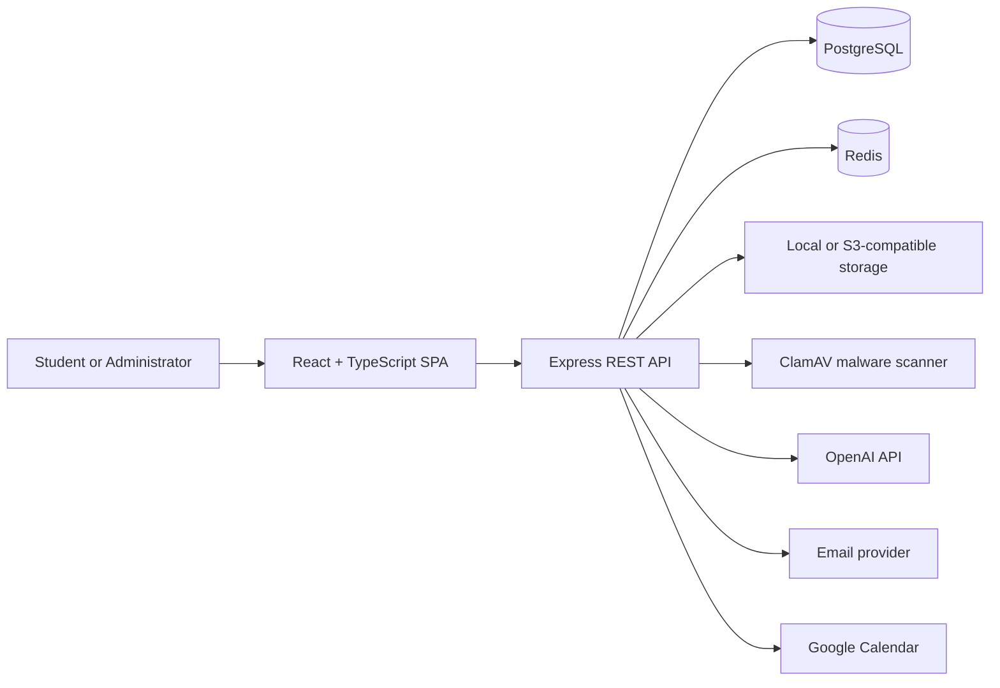

The frontend and backend are independently linted, type-checked, tested, and built by GitHub Actions.

More detail is available in [docs/architecture.md](docs/architecture.md).

---

## Security highlights

JomDekan includes several security controls beyond basic authentication.

### Authentication and authorization

- Password hashing
- Short-lived access tokens
- Refresh-token sessions
- Protected student and administrator routes
- Role-based authorization
- Email verification
- Password reset flow
- Account-level login lockout
- Administrative audit logs

### Rate limiting

- Separate policies for login, registration, refresh, and general API traffic
- Optional Redis-backed counters shared between backend instances
- Automatic in-memory fallback for local development
- Configurable limits and Redis key prefixes

### Upload protection

All supported upload paths—including academic resources, report screenshots, tutor résumés, and opportunity application files—use:

- File-size restrictions
- Actual byte-signature validation
- Content-type verification that does not trust the browser alone
- Centralized malware-scanning policy
- Removal or rejection of infected files
- Configurable ClamAV integration

The default development scanner is a clearly labelled stub and does **not** provide real antivirus protection. Production environments should configure ClamAV and require successful scanning.

Read [SECURITY.md](SECURITY.md) for configuration instructions, limitations, and the security model.

---

## Getting started

### Prerequisites

Install:

- Node.js 22+
- npm
- Docker Desktop
- Git

### Option 1: Run the full stack with Docker

Clone the repository:

```bash
git clone https://github.com/nurinirdnz/Jom-Dekan.git
cd Jom-Dekan
```

Create the root environment file.

macOS or Linux:

```bash
cp .env.docker.example .env
```

Windows PowerShell:

```powershell
Copy-Item .env.docker.example .env
```

Open `.env` and replace the example secrets with secure local values. Then start the application:

```bash
docker compose up --build -d
```

Open:

- Frontend: http://localhost:5173
- Backend: http://localhost:3000
- API documentation: http://localhost:3000/api/v1/docs
- Health check: http://localhost:3000/health

Apply seed data if required:

```bash
docker compose exec backend npm run seed
```

Stop the stack:

```bash
docker compose down
```

### Option 2: Run the application manually

Start PostgreSQL and Redis:

```bash
docker compose up -d postgres redis
```

Set up the backend:

```bash
cd backend
npm install
```

macOS or Linux:

```bash
cp .env.example .env
```

Windows PowerShell:

```powershell
Copy-Item .env.example .env
```

Apply migrations and seed data:

```bash
npm run migrate
npm run seed
npm run dev
```

In another terminal, set up the frontend:

```bash
cd frontend
npm install
```

macOS or Linux:

```bash
cp .env.example .env
```

Windows PowerShell:

```powershell
Copy-Item .env.example .env
```

Start the frontend:

```bash
npm run dev
```

Visit http://localhost:5173.

For the complete setup guide, see [docs/setup.md](docs/setup.md).

---

## Optional ClamAV scanning

Start the ClamAV service:

```bash
docker compose --profile security up -d clamav
```

Configure the backend environment:

```env
MALWARE_SCAN_PROVIDER=clamav
MALWARE_SCAN_REQUIRED=true
CLAMAV_HOST=clamav
CLAMAV_PORT=3310
```

Restart the backend after changing the configuration:

```bash
docker compose restart backend
```

ClamAV can take a few minutes to initialize and download its virus definitions during the first startup.

---

## Available commands

Run commands from the repository root.

| Task                              | Command                                                            |
| --------------------------------- | ------------------------------------------------------------------ |
| Start backend development server  | `npm --prefix backend run dev`                                     |
| Start frontend development server | `npm --prefix frontend run dev`                                    |
| Apply database migrations         | `npm --prefix backend run migrate`                                 |
| Seed development data             | `npm --prefix backend run seed`                                    |
| Create an administrator           | `npm --prefix backend run create-admin -- --email you@example.com` |
| Lint backend                      | `npm --prefix backend run lint`                                    |
| Type-check backend                | `npm --prefix backend run typecheck`                               |
| Test backend                      | `npm --prefix backend test`                                        |
| Build backend                     | `npm --prefix backend run build`                                   |
| Lint frontend                     | `npm --prefix frontend run lint`                                   |
| Type-check frontend               | `npm --prefix frontend run typecheck`                              |
| Test frontend                     | `npm --prefix frontend test`                                       |
| Run frontend E2E tests            | `npm --prefix frontend run test:e2e`                               |
| Build frontend                    | `npm --prefix frontend run build`                                  |

---

## Testing and quality checks

The project uses automated checks for both applications:

### Backend

```bash
npm --prefix backend run lint
npm --prefix backend run typecheck
npm --prefix backend test
npm --prefix backend run build
```

### Frontend

```bash
npm --prefix frontend run lint
npm --prefix frontend run typecheck
npm --prefix frontend test
npm --prefix frontend run build
```

GitHub Actions runs these checks automatically for pull requests and changes to `main`.

The security test suite covers areas such as:

- Rate-limit store selection and fallback behaviour
- Malware-scanner provider behaviour
- Infected and clean upload handling
- File-signature validation
- Resource uploads
- Report evidence
- Tutor résumés
- Opportunity CV and portfolio uploads

---

## Project structure

```text
Jom-Dekan/
├── backend/                 Express and TypeScript REST API
│   ├── scripts/             Migration, seed, and administration scripts
│   ├── src/
│   │   ├── config/          Environment, database, storage, and middleware
│   │   ├── controllers/     HTTP request handlers
│   │   ├── models/          PostgreSQL data access
│   │   ├── routes/          API routes
│   │   ├── services/        Application and integration logic
│   │   ├── types/           Shared backend types
│   │   ├── utils/           Security and general utilities
│   │   └── validators/      Request validation schemas
│   └── tests/               Unit and integration tests
├── database/
│   ├── migrations/          Numbered PostgreSQL migrations
│   ├── schema.sql           Database schema
│   └── seed.sql             Development seed data
├── docs/                    Architecture, API, setup, and design documents
├── frontend/                React and TypeScript application
│   ├── src/
│   │   ├── components/      Reusable interface components
│   │   ├── context/         React contexts
│   │   ├── hooks/           Reusable application hooks
│   │   ├── layouts/         Student and administrator layouts
│   │   ├── pages/           Routed pages
│   │   ├── service/         API clients
│   │   └── types/           Frontend types
│   └── tests/               Component and E2E tests
├── .github/workflows/       Continuous-integration workflows
├── docker-compose.yml       Local application infrastructure
├── README.md
└── SECURITY.md
```

---

## Documentation

| Document                                                       | Description                                       |
| -------------------------------------------------------------- | ------------------------------------------------- |
| [Setup guide](docs/setup.md)                                   | Detailed local setup and configuration            |
| [Architecture](docs/architecture.md)                           | System structure and technical decisions          |
| [API reference](docs/api.md)                                   | REST API overview                                 |
| [Security policy](SECURITY.md)                                 | Security controls, configuration, and limitations |
| [Implementation plan](docs/implementation-plan.md)             | Milestones and implementation status              |
| [Requirements traceability](docs/requirements-traceability.md) | Mapping between requirements and implementation   |
| [Design system](docs/design-system.md)                         | Interface and styling conventions                 |
| [Final design QA](docs/final-design-qa.md)                     | Visual and interaction quality checks             |

---

## Design goals

JomDekan is designed around:

- Clear academic information hierarchy
- Accessible light and dark themes
- Responsive student and administrator workflows
- Reusable components and centralized theme rules
- Secure file handling
- Honest development-versus-production security defaults
- Maintainable TypeScript across the complete stack
- Automated testing and pull-request-based development

---

## Current status

The core student and administrator workflows are implemented and covered by automated checks.

The project is currently intended for local development and portfolio demonstration. Production deployment would additionally require:

- Production-grade secrets management
- HTTPS and secure hosting
- Managed PostgreSQL and Redis
- Real email-provider credentials
- S3-compatible object storage
- Required ClamAV scanning
- Monitoring, alerting, and backups
- Deployment-specific security review

See [docs/implementation-plan.md](docs/implementation-plan.md) for remaining and planned work.

---

## Team

JomDekan was built by a team of five for the **Korea-ASEAN Digital Academy (KADA) Full-Stack Developer Bootcamp**:

| Name             | GitHub                                                   |
| ---------------- | -------------------------------------------------------- |
| Nurin Irdina     | [@nurinirdnz](https://github.com/nurinirdnz)             |
| Nurul Syafiqah   | [@Syfiqh](https://github.com/Syfiqh)                     |
| Syafiqah Wahidah | [@syafiqahwahidah](https://github.com/syafiqahwahidah)   |
| Nisshaliny       | [@MNissha](https://github.com/MNissha)                   |
| Elly Adriana     | [@ellyadrianna-cmd](https://github.com/ellyadrianna-cmd) |

---

## My contributions

**Nurin Irdina:** full-stack developer.

- **Project foundation and delivery:** set up the repository, Express and React project structure, Docker environment, PostgreSQL migration workflow, CI pipeline, and branch protection the team worked in; integrated teammates' features and fixed cross-feature conflicts and regressions to keep `main` stable.
- **Authentication and core data model:** built the first version of authentication (JWT access tokens and rotating refresh sessions with reuse detection) and wrote the core database schema for users, sessions, and the academic taxonomy.
- **AI study tools:** built AI resource summaries, multi-file source selection, document text extraction, and the "Ask This Resource" assistant with citations and formatted answers.
- **Academic resources:** rebuilt resource browsing and filtering, built PDF and spreadsheet previews and the admin resource management page, and extended the upload and resource-detail pages.
- **Security:** added Redis-backed distributed rate limiting, configurable ClamAV malware scanning, and Row-Level Security on all database tables, and extended file-signature validation to every upload path.
- **Reporting and moderation:** built reporting across all content types with screenshot evidence, and extended moderation with full content previews, decision workflows, response templates, and notifications.
- **Design system and accessibility:** created reusable UI components and implemented platform-wide dark mode with accessible contrast and focus states.
- **Testing:** wrote most of the project's automated tests (frontend, backend, integration, and upload security), which run in CI on every pull request.

A detailed breakdown is in [docs/contributions.md](docs/contributions.md).

## Repository

[github.com/nurinirdnz/Jom-Dekan](https://github.com/nurinirdnz/Jom-Dekan)
